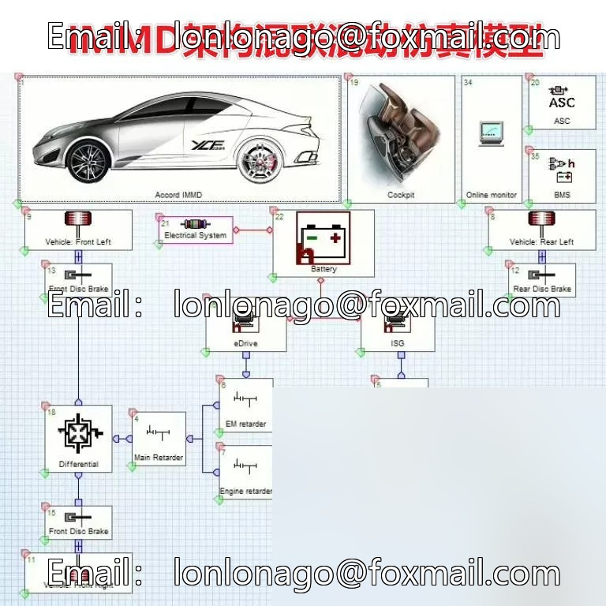
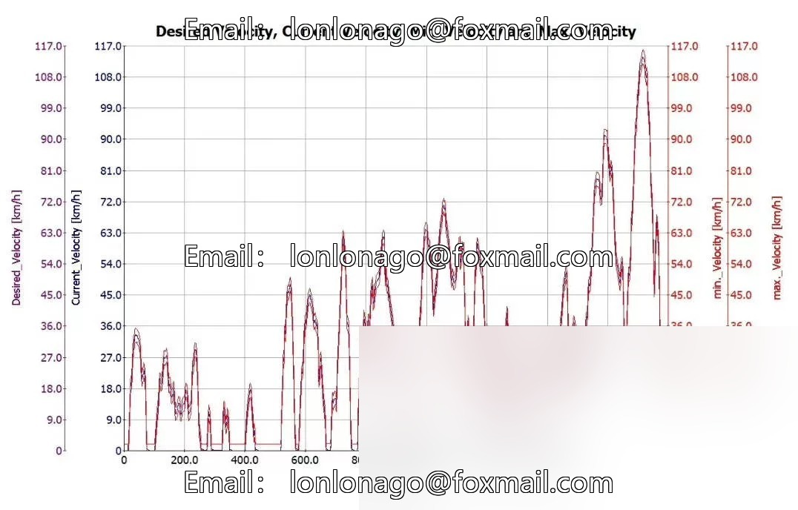
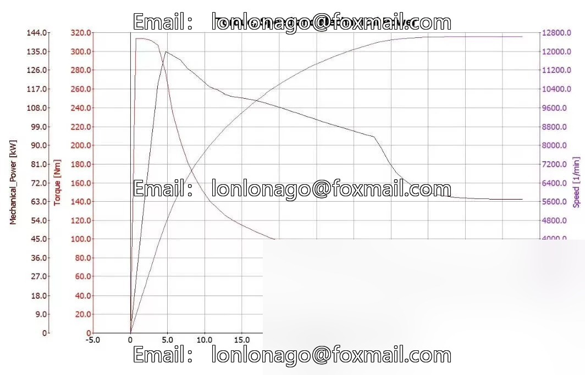
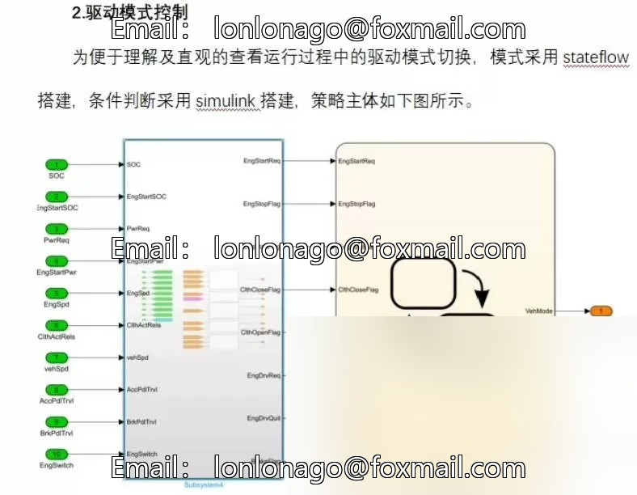
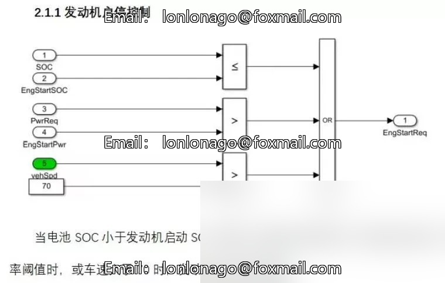

# IMMD architecture hybrid-simulation hybrid-motion simulation model (im)

## Body

IMMD architecture combined hybrid simulation model cruise hybrid simulation model (immd), P1+P3 architecture, simulation of power characteristics and economic efficiency of combined hybrid vehicles.
It includes cruise model, simulink strategies, and strategy file descriptions (19 pages).

Regarding the model
1. This model is a hybrid powertrain simulation model based on the IMMD architecture.
The model is based on a base model built using Cruise/Simulink, with the strategy model built on the MATLAB/Simulink platform. It is compiled into a dll file using a C++ compiler and referenced by CRUISE to realize joint simulation.
2. Detailed strategy explanations are provided, with approximately 19 pages, mainly explaining the logic of strategy construction and the conversion among various modes.
3. The model is mainly used for learning purposes. Since the control strategies for different vehicle models will inevitably be different, specific vehicle model simulation tasks should be adjusted based on requirements when changing the model.
4. Please ensure you have corresponding software foundation before using the model. The model is sold, not software tutorials.

5. Provide all relevant documents.
Including: cruise model, simulink strategy model, strategy description documents.
6. DLL files are compiled using a 64-bit compiler; if a prompt for policy files appears, please select "options → layout → platform → WIN64" in the model interface;
If it still cannot run, please check whether the model directory contains Chinese characters.
7. Look carefully before purchasing; no exchange or refunds upon sale.

web-based shipment, can be directly photographed and shipped.

The model is an IMDM-based hybrid drive simulation, built with cruise, simulink and strategy files, covering drive mode control, SOC and multiple power parameters; the images show related architectures, parameters and runtime state.

<!-- AI_ENRICHED -->

## Images

## Payment

Here is a pay link on Stripe ( https://buy.stripe.com/3cs8yP7sY87d0vu9AB ). Please contact me lonlonago@foxmail.com after funding $89, and I will send you a complete data files , thank you!

